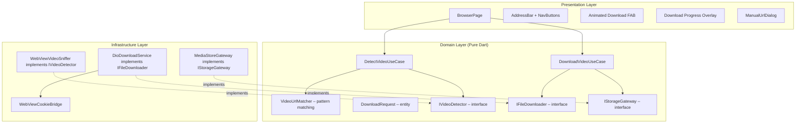

# 🎬 Flutter Video Downloader – Revised Implementation Plan (v2)

> [!IMPORTANT]
> This revision addresses all points from the review. Changes from v1 are marked with 🔄.

---

## Overview

A single-screen Flutter app providing an in-app Chromium browser with **best-effort** video URL detection and one-tap download to the Android Downloads directory. MVP targets **direct .mp4/.webm files only**.

---

## Architecture (Clean Architecture – Fixed)

🔄 **Fixed dependency rule:** Presentation no longer depends on infrastructure directly. Domain defines interfaces; infrastructure implements them.



> **Dependency Rule:** Presentation → Domain ← Infrastructure. Domain defines `IVideoDetector`, `IFileDownloader`, `IStorageGateway` interfaces. Infrastructure implements them. Presentation only calls use-cases.

---

## Phase 1 – Project Configuration

### 1.1 `pubspec.yaml`

| Package | Version | Purpose |
|---------|---------|---------|
| `flutter_inappwebview` | `^6.1.5` | Chromium WebView with network interception |
| `dio` | `^5.7.0` | HTTP download with progress callbacks |
| `path_provider` | `^2.1.4` | Temporary file storage before MediaStore commit |
| `permission_handler` | `^11.3.1` | Runtime permissions (legacy Android ≤ 9) |

### 1.2 `AndroidManifest.xml` Changes

🔄 **Tightened security:** No cleartext traffic. No broad permissions.

```xml
<!-- Before <application> -->
<uses-permission android:name="android.permission.INTERNET" />
<uses-permission android:name="android.permission.WRITE_EXTERNAL_STORAGE"
    android:maxSdkVersion="28" />

<!-- On <application> tag — NO usesCleartextTraffic -->
<!-- NO networkSecurityConfig override -->
```

> [!NOTE]
> `usesCleartextTraffic` is **not** set. HTTPS is required by default. If a specific site needs HTTP, we can add domain-specific exceptions later.

### 1.3 `build.gradle.kts` Change

```kotlin
minSdk = 19  // flutter_inappwebview requires >= 19
```

🔄 **Removed:** The overly-permissive `network_security_config.xml` file is no longer created.

---

## Phase 2 – Domain Layer

### 2.1 `VideoUrlMatcher` (pure Dart utility)

- **Input:** A URL string
- **Output:** `bool` indicating whether this looks like a downloadable video
- **MVP scope:** Only `.mp4` and `.webm` extensions
- 🔄 **Excluded from MVP:** `.m3u8`, `.ts`, `.mpd` (streaming — see Phase 7)
- **Logic:**
  - Check URL path (before query string) for `.mp4` / `.webm` extension
  - Check `Content-Type` header if available (`video/mp4`, `video/webm`)
  - Reject known false positives: tracking pixels, ad domains, files < 100KB
  - 🔄 Does **not** lowercase the full URL — only the path component for matching

### 2.2 `DownloadRequest` (entity)

```dart
class DownloadRequest {
  final String url;           // Original, unmodified URL (preserves signatures)
  final String suggestedFileName;
  final DateTime detectedAt;
  final Map<String, String>? headers;  // 🔄 Cookies/auth from WebView session
}
```

### 2.3 Interfaces (defined in domain, implemented in infrastructure)

```dart
abstract class IVideoDetector {
  Stream<DownloadRequest> get detectedVideos;
  void addManualUrl(String url);  // 🔄 Manual fallback
}

abstract class IFileDownloader {
  Future<void> download(DownloadRequest request, {
    required void Function(double progress) onProgress,
    required void Function(String savedPath) onComplete,
    required void Function(String error) onError,
  });
  void cancel();
}

abstract class IStorageGateway {
  /// Returns the final saved file path
  Future<String> saveToDownloads(String tempFilePath, String fileName);
}
```

### 2.4 Use Cases

```dart
class DetectVideoUseCase {
  // Forwards IVideoDetector.detectedVideos stream to presentation
  // Applies VideoUrlMatcher filtering
}

class DownloadVideoUseCase {
  // 1. Downloads to temp file via IFileDownloader
  // 2. On success: moves to Downloads via IStorageGateway
  // 3. On failure: cleans up temp file
}
```

---

## Phase 3 – Infrastructure Layer

### 3.1 `WebViewVideoSniffer` – Best-Effort Detection

🔄 **Honest assessment:** Detection is best-effort, not guaranteed. Multiple strategies improve coverage but cannot promise universal detection.

| # | Strategy | Limitations |
|---|----------|-------------|
| 1 | `shouldInterceptRequest` | Android only; misses `blob:` URLs; sees only initial URL on redirects |
| 2 | `onLoadResource` | Fires after load; may lack sufficient metadata to identify video |
| 3 | JS: Override `fetch()` + `XHR.open()` | May miss non-fetch/XHR media loading; could interfere with site behavior |
| 4 | JS: Periodic `<video>` tag scan | May find `blob:` URLs that aren't independently downloadable |

🔄 **Fallback:** A "Paste URL" manual entry option in the UI for when auto-detection fails.

#### Deduplication (Fixed)

🔄 **Revised approach:** 
- Normalize only **scheme + hostname** (lowercase)
- Preserve path and query string **exactly as-is** (signed URLs, case-sensitive paths)
- Deduplicate by comparing the full normalized string
- Store original URL for the actual download

### 3.2 `DioDownloadService`

🔄 **Session-aware downloads:**

```dart
class DioDownloadService implements IFileDownloader {
  // 1. Retrieve cookies from InAppWebView's CookieManager for the video URL's domain
  // 2. Attach cookies + Referer header to Dio request
  // 3. Download to TEMP directory first (via path_provider)
  // 4. Report progress via callback
  // 5. On completion: call IStorageGateway.saveToDownloads()
  // 6. On failure: delete temp file, report error
}
```

> [!WARNING]
> Dio is a separate HTTP client from the WebView. Without forwarding cookies, downloads from authenticated/session-protected sources will fail with 403.

### 3.3 `MediaStoreGateway` (Fixed Storage)

🔄 **Completely redesigned:** Uses MediaStore on Android 10+, legacy path on Android 9-.

```dart
class MediaStoreGateway implements IStorageGateway {
  Future<String> saveToDownloads(String tempFilePath, String fileName) async {
    if (Platform.isAndroid) {
      final sdkInt = await _getAndroidSdkVersion();
      if (sdkInt >= 29) {
        return _saveViaMediaStore(tempFilePath, fileName);
      } else {
        return _saveLegacy(tempFilePath, fileName);
      }
    }
    throw UnsupportedError('Only Android is supported');
  }
}
```

**Android 10+ (API 29+) — MediaStore approach:**
1. Create a `ContentValues` entry in `MediaStore.Downloads` via platform channel
2. Get the output `Uri` from the content resolver
3. Open an `OutputStream` to that Uri
4. Copy the temp file contents into it
5. Mark `IS_PENDING = 0` to finalize (makes file visible to user)
6. Delete the temp file

**Android 9 and below (API ≤ 28):**
1. Request `WRITE_EXTERNAL_STORAGE` via `permission_handler`
2. Copy temp file to `/storage/emulated/0/Download/`
3. Handle filename collisions

> [!IMPORTANT]
> This requires a **platform channel** (MethodChannel) to call Android's `ContentResolver` + `MediaStore` APIs from Dart. This is the correct modern approach — `path_provider` alone cannot do this.

---

## Phase 4 – Presentation Layer

### 4.1 `BrowserPage` (single StatefulWidget)

```
┌─────────────────────────────────┐
│ [←] [→] [🔄] [ URL TextField ] [Go] │  ← Address Bar
├─────────────────────────────────┤
│  ▓▓▓▓░░░░░░░░░░░░░░ 25%       │  ← Page loading progress (thin)
├─────────────────────────────────┤
│                                 │
│        InAppWebView             │
│     (full remaining space)      │
│                                 │
│                                 │
│                      [📎] [⬇️] │  ← Manual paste + Animated download FAB
│                                 │
├─────────────────────────────────┤
│  ▓▓▓▓▓▓▓░░░ 65% video.mp4     │  ← Download progress (shown during download)
└─────────────────────────────────┘
```

### 4.2 Address Bar Behavior

- `TextEditingController` bound to URL field
- On submit: load URL (auto-prepend `https://` if missing)
- Updates as user navigates (via `onUpdateVisitedHistory`)
- Shows page loading progress via `onProgressChanged` (thin `LinearProgressIndicator`)

### 4.3 Animated Download FAB

- Hidden by default (`ScaleTransition` + `AnimationController`)
- When `VideoUrlMatcher` confirms a new video URL → animate in (scale 0→1 with bounce)
- Badge shows count of detected videos if > 1
- Tap → show bottom sheet listing detected URLs with filename + "Download" button
- 🔄 Each entry shows: filename, file extension badge, detected source

### 4.4 🔄 Manual URL Entry (Fallback)

- Small secondary FAB (📎 icon) always visible
- Opens a dialog with a `TextField` to paste a video URL manually
- Validates with `VideoUrlMatcher` before adding to candidate list
- **Critical for Brave compatibility** — when auto-detection misses a video

### 4.5 Download Progress & Lifecycle

🔄 **Added:** Cancel, error, and completion states.

| State | UI |
|-------|-----|
| Idle | Progress bar hidden |
| Downloading | `LinearProgressIndicator` + filename + percentage |
| Completed | `SnackBar` with "Open file" action |
| Error | `SnackBar` with error message + "Retry" action |
| Cancelled | Temp file cleaned up, progress bar hidden |

### 4.6 🔄 WebView Settings (Tightened)

```dart
InAppWebViewSettings(
  // Detection hooks:
  useShouldInterceptRequest: true,
  useOnLoadResource: true,
  useShouldInterceptFetchRequest: true,
  useShouldInterceptAjaxRequest: true,
  // Media playback:
  allowsInlineMediaPlayback: true,
  mediaPlaybackRequiresUserGesture: false,
  // Security (tightened):
  javaScriptEnabled: true,
  domStorageEnabled: true,
  // 🔄 REMOVED: mixedContentMode ALWAYS_ALLOW
  // 🔄 REMOVED: hardcoded Chrome user-agent
  // 🔄 REMOVED: thirdPartyCookiesEnabled (use default)
)
```

> 🔄 **No fake user-agent.** The system WebView already identifies as Chrome/Chromium. Adding a hardcoded outdated version is counterproductive.

---

## Phase 5 – Platform Channel for MediaStore

🔄 **New phase** — required for correct Android storage.

### `android/app/src/main/kotlin/.../MediaStoreHelper.kt`

```kotlin
// Platform channel: "com.example.downloader/mediastore"
// Method: "saveToDownloads"
// Args: { "tempPath": String, "fileName": String, "mimeType": String }
// Returns: saved file URI string

// Implementation:
// 1. ContentValues with DISPLAY_NAME, MIME_TYPE, RELATIVE_PATH = "Download"
// 2. Set IS_PENDING = 1
// 3. contentResolver.insert(MediaStore.Downloads.EXTERNAL_CONTENT_URI, values)
// 4. Copy file from tempPath to output stream
// 5. Update IS_PENDING = 0
// 6. Delete temp file
// 7. Return URI
```

### `android/app/src/main/kotlin/.../MainActivity.kt`

Register the `MethodChannel` and delegate to `MediaStoreHelper`.

---

## Phase 6 – File Structure

```
lib/
├── main.dart                              # App entry, MaterialApp, DI wiring
├── domain/
│   ├── video_url_matcher.dart             # Pure Dart URL pattern matching
│   ├── download_request.dart              # Download entity
│   ├── i_video_detector.dart              # Interface
│   ├── i_file_downloader.dart             # Interface
│   ├── i_storage_gateway.dart             # Interface
│   ├── detect_video_use_case.dart         # Use case
│   └── download_video_use_case.dart       # Use case
├── infrastructure/
│   ├── webview_video_sniffer.dart         # Multi-strategy detection
│   ├── dio_download_service.dart          # Dio + cookie bridge
│   ├── media_store_gateway.dart           # Platform channel to MediaStore
│   └── webview_cookie_bridge.dart         # Extract cookies from WebView
└── presentation/
    ├── browser_page.dart                  # Main single-screen widget
    └── widgets/
        ├── address_bar.dart               # URL field + nav buttons
        ├── animated_download_fab.dart     # Animated FAB with badge
        ├── download_progress_bar.dart     # Bottom progress indicator
        └── manual_url_dialog.dart         # Paste URL fallback

android/app/src/main/kotlin/.../
├── MainActivity.kt                        # MethodChannel registration
└── MediaStoreHelper.kt                   # MediaStore.Downloads API
```

---

## Phase 7 – Execution Order

| Step | Action | Files |
|------|--------|-------|
| 1 | Update `pubspec.yaml` | `pubspec.yaml` |
| 2 | Configure Android manifest (permissions only, no cleartext) | `AndroidManifest.xml` |
| 3 | Set `minSdk = 19` in build.gradle.kts | `build.gradle.kts` |
| 4 | Create Kotlin platform channel for MediaStore | `MediaStoreHelper.kt`, `MainActivity.kt` |
| 5 | Create domain layer (entities, interfaces, use cases) | `domain/*.dart` |
| 6 | Create infrastructure layer | `infrastructure/*.dart` |
| 7 | Create presentation widgets | `presentation/widgets/*.dart` |
| 8 | Create browser page | `presentation/browser_page.dart` |
| 9 | Wire everything in `main.dart` | `main.dart` |
| 10 | Run `flutter pub get` + `flutter run` | — |
| 11 | Test against target websites | — |

---

## Phase 8 – Deferred (Post-MVP)

| Feature | Why deferred |
|---------|-------------|
| HLS `.m3u8` download | Requires playlist parsing, segment downloading, and reassembly |
| DASH `.mpd` support | Similar complexity to HLS |
| `.ts` segment handling | Meaningless without HLS context |
| DRM-protected content | Must not attempt to bypass content protection |
| Concurrent downloads | Adds complexity to progress UI and resource management |
| iOS support | Requires WKWebView-specific detection and different storage APIs |

---

## Phase 9 – Testing Matrix

| Area | Cases |
|------|-------|
| **Detection** | Direct .mp4 link, .webm link, redirected URL, `blob:` URL (expect miss), ad/tracker false positive rejection |
| **Downloads** | Successful file, 403 response, 404 response, expired/signed URL, unknown Content-Length |
| **Storage** | Android 9 legacy path, Android 10+ MediaStore, insufficient disk space, duplicate filename |
| **Session** | Public video (no auth), cookie-protected video (session required) |
| **Lifecycle** | Progress reporting, user cancellation, temp file cleanup on failure |
| **UI** | Back/forward navigation, invalid URL entry, multiple candidates in sheet, manual URL paste, completion SnackBar |

---

## Brave Compatibility — Honest Assessment

🔄 **Revised statement:**

> The application uses **Android System WebView** (Chromium-based) to browse websites and **attempts** to detect downloadable media via network interception and DOM inspection. It is **not** the Brave browser and does not share Brave's engine, profile, extensions, or Shields.
>
> **Compatibility depends on each website's delivery method, authentication, and content-protection mechanisms.** When automatic detection fails, the manual URL paste option provides a reliable fallback.
>
> The app can be tested and verified against specific target websites, but universal detection across all sites cannot be guaranteed.

---

## Summary of Changes from v1

| Issue | v1 (Original) | v2 (Revised) |
|-------|---------------|--------------|
| Detection reliability | "Guaranteed universal" | Best-effort + manual fallback |
| Storage | Direct path write | MediaStore.Downloads via platform channel |
| Network security | Cleartext + mixed content allowed | HTTPS only, no overrides |
| User-Agent | Hardcoded Chrome 120 | System default |
| Streaming formats | .m3u8/.ts in MVP | Deferred to post-MVP |
| Cookie forwarding | Not addressed | WebView → Dio cookie bridge |
| URL normalization | Lowercase + strip params | Normalize scheme+host only, preserve rest |
| Architecture | Presentation → Infrastructure | Presentation → Domain ← Infrastructure |
| Testing | `flutter run` only | Full test matrix defined |
| Brave claim | "Guaranteed" | Honest best-effort assessment |
